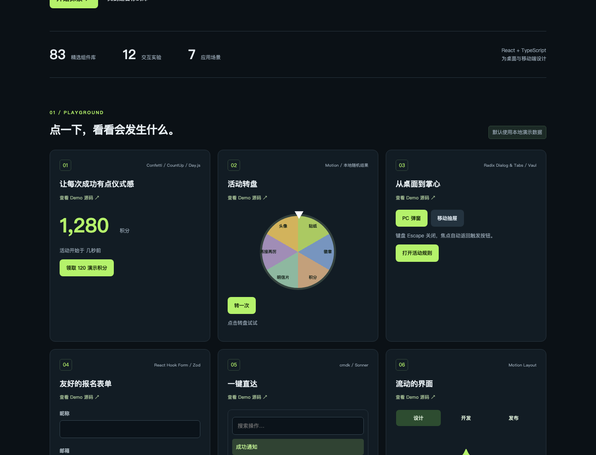

# Activity Lab · React UI & Web3 组件实验室

面向活动页、业务后台和 Web3 DApp 的 **React + TypeScript 教学 Demo**。涵盖 PC / 移动端 UI、动画组件、表单校验、数据表格、钱包连接和智能合约交互，原有撒花、数字滚动、Day.js、转盘、Zendesk 示例已补成可操作代码。

**83 个组件库选型条目 · 12 个交互实验 · 7 类应用场景**。目录区支持关键词、场景和覆盖状态筛选。没有把所有目录条目都安装到项目：16 个库有主站实现，10 个有独立接入配方，其余提供官方选型入口。



[查看移动端预览](docs/preview-mobile.png)

## 快速运行

需要 Node.js 22+、npm。

```bash
npm ci
npm run dev
# 打开终端显示的本地地址
npm run build
npm run preview
```

默认使用本地演示数据，不需要 API key、钱包或网络请求。依赖首次安装需要联网；打开外部文档、使用真实钱包 RPC 或配置客服时会联网。不会自动连接钱包或发送交易。

## 可运行 Demo

| 实验 | 库与行为 | 源码 |
|---|---|---|
| 撒花 / 数字 / 时间 | canvas-confetti、CountUp、Day.js；点击增加积分 | [Demos.tsx](src/components/Demos.tsx) |
| 转盘 | Motion 旋转、本地随机结果、重复点击保护 | 同上 |
| PC 弹窗 / 手机抽屉 | Radix Dialog / Tabs、Vaul；焦点和关闭交互 | 同上 |
| 报名表单 | React Hook Form + Zod；错误提示、重置、Toast | 同上 |
| 命令菜单 | cmdk + Sonner；键盘选择、异步任务提示 | 同上 |
| 动效卡片 | Motion 布局动画、减少动态效果偏好 | 同上 |
| 拖拽排序 | dnd-kit；鼠标、触屏和键盘操作 | 同上 |
| 二维码 | QRCode React；动态输入、空状态 | 同上 |
| 客服 | Zendesk 按需单例加载、本地预览、失败重试 | [zendesk.ts](src/lib/zendesk.ts) |
| 数据表格 | TanStack Table；排序、筛选、分页、空状态 | [DataDemo.tsx](src/components/DataDemo.tsx) |
| 活动图表 | Recharts 响应式面积图 | 同上 |
| 钱包与合约 | Viem、EIP-6963、EIP-1193；读取→模拟→签名→确认 | [WalletDemo.tsx](src/components/WalletDemo.tsx) |

表单不上传数据；积分/转盘状态刷新后重置。客服不配置 key 时展示本地预览。

## 本地合约完整流程

```bash
# 终端 1：编译 Solidity、启动 Ganache、部署 Counter
npm run chain
# 终端 2
npm run dev
```

1. 将终端输出的 Counter 地址填入页面。无需钱包即可点击「读取 count」。
2. 使用专门的测试钱包，导入脚本显示的**公开测试助记词**。它仅供本地教学，绝不能用于真实资产。
3. 连接浏览器钱包，点击「切换本地链」（RPC `http://127.0.0.1:8545`，chain ID `31337`）。
4. 点击「模拟并提交 +1」，在钱包核对方法和网络后确认；页面等待 receipt 成功后刷新计数。
5. Ctrl+C 停止链，数据随之清空。也可复制 `.env.example` 为 `.env.local` 配置合约地址，修改后重启 Vite。

只在本地链开放写操作。移动端钱包内置浏览器支持注入 Provider；手机扫码、普通移动浏览器跳钱包请看独立 WalletConnect 配方。本地 RPC 默认只监听本机，真机测试建议使用测试网，不公开暴露 Ganache。

## 更多库与复制代码

- [83 个库的场景选型表](docs/catalog.md)：Ant Design、MUI、Mantine、shadcn/ui、Vant、Ionic、GSAP、Rive、Three Fiber、Magic UI、React Bits 等。
- [独立接入配方](recipes/README.md)：RainbowKit、Reown AppKit、wagmi、Solana Wallet Adapter、TON Connect、Ant Design Mobile、Swiper、Three Fiber / GSAP、ERC20 / OpenZeppelin。
- [按业务组合与配方安装命令](docs/selection.md)：后台、手机活动、营销视觉、EVM、多链和 ERC20。
- [架构、学习路径及移动端适配](docs/architecture.md)：状态边界、交易流程、后端如何补齐。

配方是独立项目代码，不属于主站已编译/已验证功能。第三方项目的许可证、收费功能和 API 版本以各自官方资料为准。目录 package 字段是检索标识，源码分发组件须按官方 CLI 操作。

## 验证

```bash
npm test                 # 目录检查 + 真实本地链合约生命周期
npm run build            # TypeScript + Vite
npx playwright install chromium
npm run test:e2e         # Chromium 桌面和手机视口
```

合约测试验证模拟不改状态、交易确认、事件、非 payable 拒绝和非法调用回滚。浏览器测试覆盖筛选、弹窗/抽屉、表单、表格、客服预览、转盘、二维码、模拟钱包状态变化，以及页面调用真实本地 RPC 完成交易确认。真实钱包 App、WalletConnect projectId、Zendesk 账号接入仍需自行完成真机联调。

## 原始参考

保留最初素材：[转盘参考](https://100px.net/demo/more.html)、[撒花参考](https://www.kirilv.com/canvas-confetti/)、[转盘截图](image.png)、[撒花截图](image-1.png)。
