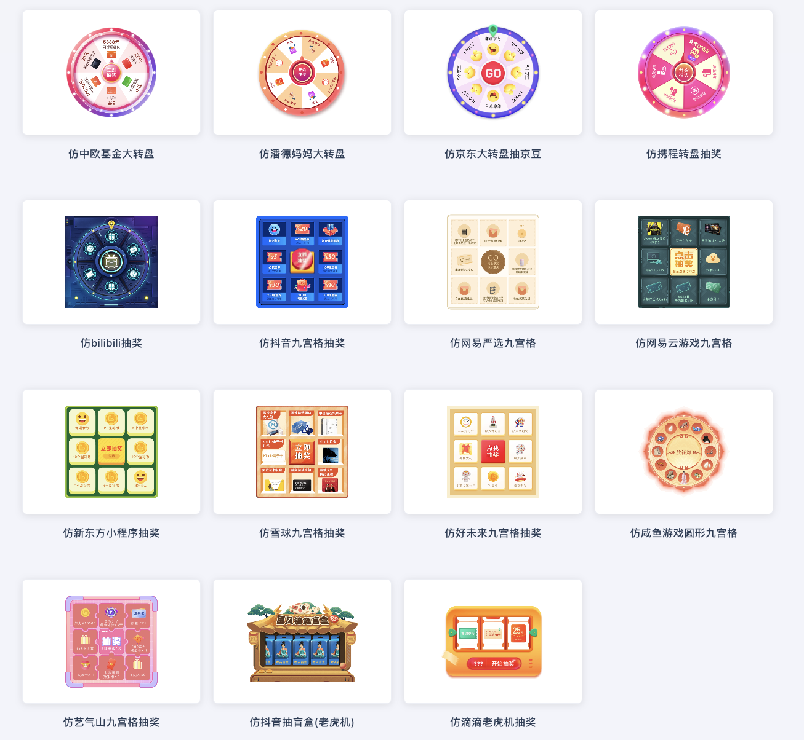
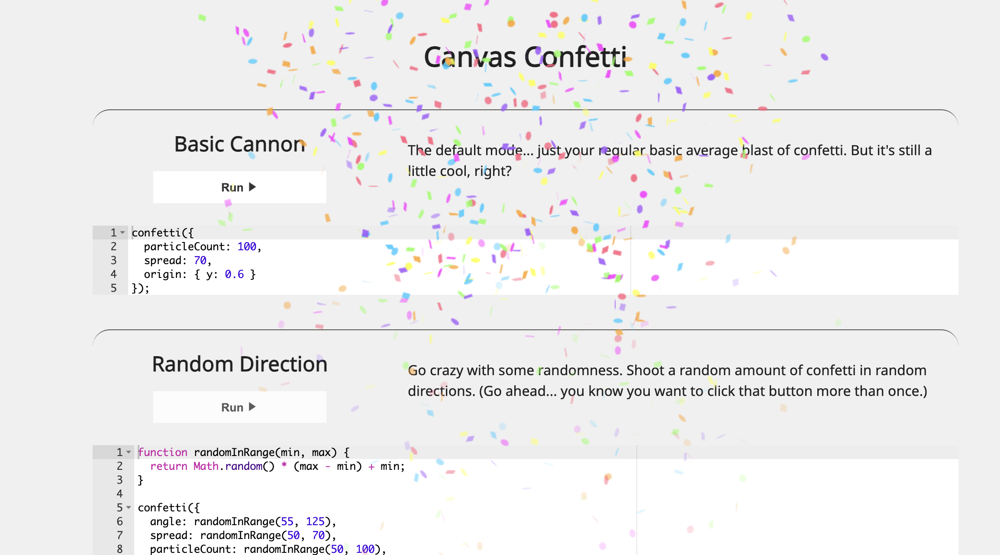

# 活动页交互插件与接入记录

整理活动页中常用的转盘、撒花、数字滚动、相对时间和客服组件资料。本目录只有文档与截图，没有package.json、可启动站点或封装好的插件源码；下面片段需要放入相应业务项目中适配。

<!-- BEGIN project-discovery -->
## 项目定位与实践入口

Frontend interaction integration notes: canvas-confetti, react-countup, Day.js and Zendesk Web Widget. 活动页抽奖、撒花动画、数字滚动与客服组件接入资料。

适合从以下入口阅读实现与接入条件：

- [组件接入示例与参考资料](README.md)
<!-- END project-discovery -->

## 内容导航与接入条件

| 主题 | 目录内容 | 宿主需要处理 |
|---|---|---|
| 转盘抽奖 | 外部参考与截图 | 业务奖项、结果接口和动画交互 |
| 撒花动画 | 外部插件链接与截图 | 容器、触发时机和重复播放清理 |
| 数字滚动 | react-countup安装示例 | React宿主、实际数值和样式 |
| 相对时间 | dayjs片段 | 导入relativeTime插件后extend，核对秒/毫秒单位 |
| Zendesk客服 | 动态加载片段 | 替换自己的widget key，提供语言获取方法，避免重复注入脚本 |

## 使用方式

先定位下面的原始记录，再到实际应用的依赖管理和生命周期中接入。示例中的 `getZELang()` 属于宿主业务方法，本目录不提供实现；原客服key已替换为占位值。

没有本地安装、构建或测试命令。本轮保留已有外链与截图，未联网核实第三方链接可用性，也没有为这些链接附加兼容性或版本保证。

## 原始参考记录

### 	1、转盘抽奖

https://100px.net/demo/more.html


### 	2、撒花🎉 插件

https://www.kirilv.com/canvas-confetti/


###     3、数字滚动插件

```
npm install react-countup
或者
yarn add react-countup
```

###     4、时间处理距离现在

```
// day.js 轻量级
import dayjs from 'dayjs'
dayjs.extend(relativeTime)
```

dayjs(Number(v) * 1000).fromNow()

###     5、zdassets 三方客服插件
文档 https://developer.zendesk.com/documentation/zendesk-web-widget-sdks/sdks/web/getting_started/
```
export const initZendeskService = () => {
  // 引入zendesk在线客服
  const head = document.getElementsByTagName('head')[0]
  const script = document.createElement('script')
  script.id = 'ze-snippet'
  script.src = 'https://static.zdassets.com/ekr/snippet.js?key=YOUR_ZENDESK_WIDGET_KEY'
  script.onload = () => {
    if (window.zE) {
      window.zE("messenger:set", "locale", getZELang())
      window.zE('messenger', 'close');
    }
  }
  head.appendChild(script)

}
```

