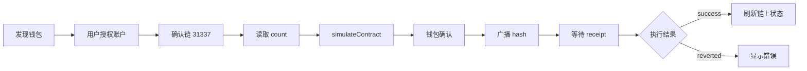

# 架构与学习路径

## 目录职责

- `src/main.tsx`：页面分区、目录搜索和场景筛选。
- `src/catalog.json`：83 个库的单一数据源；每项明确可运行、配方或仅选型。
- `src/components/Demos.tsx`：活动插件、交互、表单、拖拽、二维码、客服。
- `src/components/DataDemo.tsx`：可排序分页表格、固定数据图表，按模块懒加载。
- `src/components/WalletDemo.tsx`：浏览器钱包发现、账户状态、本地链合约生命周期。
- `src/lib`：本地链 ABI / RPC 与第三方脚本单例加载器。
- `contracts` / `scripts` / `tests`：可部署 Counter、本地链、真实 RPC 测试和浏览器测试。
- `recipes`：独立项目接入代码，避免主应用引入所有生态 SDK。

不把 Ant Design、MUI、Mantine 等整套系统同时装进一个页面。先选一套主设计系统，再按需组合无样式交互、表单和动画库。Vaul、Radix 处理交互基础，页面仍需提供合适标题、对比度和键盘焦点。

## 建议学习顺序

1. 运行页面，阅读 `Celebration`：副作用清理、减少动态效果、相对时间刷新。
2. 阅读 `Signup` / `Overlays`：校验错误、焦点返回、移动抽屉和表单提交状态。
3. 阅读 `DataDemo` / `SortableDemo`：状态排序、筛选、分页和键盘拖拽。
4. 阅读 `WalletDemo`：先理解链和账户，再运行本地 Counter。
5. 为独立项目选择 RainbowKit / Reown 配方，再考虑 Solana / TON 等其他生态。
6. 最后接业务后端：服务端抽奖结果、活动幂等、签名登录、客服配置。

## 钱包与交易流程

模拟不会修改链上数据。返回交易 hash 也不代表成功，必须检查 receipt.status。事件监听在组件卸载或更换 Provider 时释放；账户/网络变化使进行中的模拟结果失效。断开本站连接只是清理页面状态，不等同撤销钱包内的站点授权。

Counter 不托管资金、不需要 ETH value；但签名仍消耗测试 gas。网页写操作仅允许 chain ID 31337。链 ID 本身不是安全边界：本地教学 RPC 和合约地址应由开发者控制；生产接入必须校验部署网络及合约代码。

## PC / 手机适配

- 窄屏单列卡片、触摸尺寸按钮、底部抽屉、输入法友好的类型。
- 二维码需要有文本替代说明；扫码内容不自动执行。
- 手机 `localhost` 是手机自己。默认本地 RPC 仅绑定 127.0.0.1，不能直接从手机访问；跨设备演示建议使用测试网与受信任 HTTPS 开发环境，切勿将解锁账户的 Ganache 暴露到公网。
- 真机钱包深链/回跳需要 WalletConnect 配方和真实 App 测试；Playwright 手机视口仅验证页面交互与布局。
- 尊重 `prefers-reduced-motion`，避免自动音频、循环闪烁和首屏外部字体请求。

## 上线前应补的业务层

演示转盘只在内存中随机抽结果；真实奖品必须由后端决定、核验资格、扣减库存、防重复领奖，再由前端播放到指定结果。此仓库没有支付或真实抽奖结算逻辑。

真实看板接入 Query 缓存、分页接口与权限；表单接服务端校验；钱包登录接 SIWE；索引服务处理合约事件和区块重组；多链写操作分别核对费用、nonce 和授权范围。超时后先查询已有 hash，避免重复发交易。

## 依赖与验证边界

主应用版本以 `package-lock.json` 为准；安装依赖用于教学覆盖，不等于建议生产项目全部引入。图表与 Viem 拆成按需模块；上线时继续按路由分包，并审计真实构建体积。独立配方不参与主站的 TypeScript 构建，不宣称已经完成真实钱包厂商、第三方客服或测试网端到端认证。
